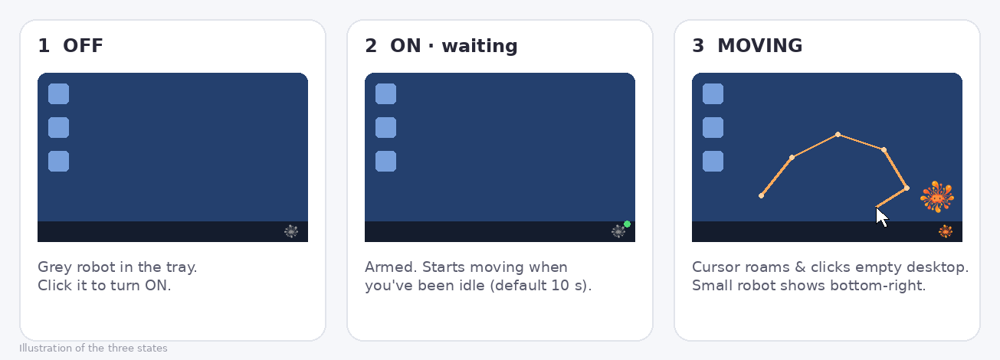
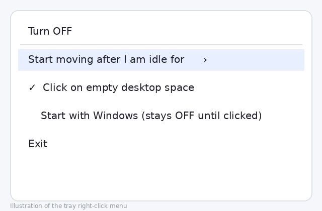

<div align="center">


# Auto Cursor Robo

**A tiny tray robot that keeps your Windows PC awake while you're away — and gets out of the way the moment you're back.**


</div>

---

## Why?

Your screen locks, your chat app turns "Away", a download-heavy session times out, or a remote
session drops — all because Windows thinks you left. Auto Cursor Robo fixes that **only while you
are really away**:

- Moves the mouse in natural, human-looking paths so Windows and apps see activity.
- Blocks the screen from turning off / the PC from sleeping while it is working.
- **Stops instantly** when you touch the mouse or keyboard — it never fights you for control.

## Features

| | |
|---|---|
| 🤖 **Auto-pilot cursor** | Smooth Bézier curves, circles, figure-eights, spirals, waves and zig-zags — randomized every time. |
| 🖱️ **Empty-space clicks** | When the pointer is over the bare desktop it occasionally clicks there. It never clicks on app windows. |
| ✋ **Instant hand-back** | Any *real* key press or mouse action turns it OFF immediately (its own synthetic input is ignored). |
| 🟠 **Small robot indicator** | A small, click-through `AutoCursorRobo.ico` appears bottom-right while it is moving, so you always know. |
| ⏱️ **Idle timer** | Starts after 5 s, 10 s, 30 s, 1 min, 2 min or 5 min of inactivity — your choice. |
| 🔔 **Tray control** | Grey robot = OFF, colour robot = moving. Click to toggle, right-click for settings. |
| 🪶 **Featherweight** | One small `.exe`, no runtime to install, no admin rights, no telemetry, no network access. |
| 🔁 **Single instance** | Launching the shortcut again simply toggles the running copy. |

## How it looks

> The images below are illustrations of the states and menu.

<div align="center">

</div>

<div align="center">

</div>

## Quick start

**Requirements:** Windows 10 or 11. Nothing else — the app is compiled with the C# compiler
that already ships with Windows (.NET Framework 4).

```bat
git clone https://github.com/SKABDULAHMED8/AutoCursorRobo.git
cd AutoCursorRobo
install.bat
```

`install.bat` builds the app, copies it to `%LOCALAPPDATA%\AutoCursorRobo`, creates **Desktop** and
**Start Menu** shortcuts, and launches it. The robot appears in the system tray (bottom-right —
check the `^` overflow arrow).

Prefer to just build? Run `build.bat` → `bin\AutoCursorRobo.exe`.

## Usage

1. **Click the tray robot** (or the Desktop shortcut) → Auto Cursor Robo is **ON** and armed.
2. Walk away. After your chosen idle time the cursor starts moving and the small robot appears.
3. **Come back and touch the mouse or any key** → it stops, the robot disappears, tray goes grey (**OFF**).
4. Click the tray robot again whenever you want it back.

### Right-click menu

| Item | What it does |
|---|---|
| **Turn ON / OFF** | Same as left-clicking the tray icon. |
| **Start moving after I am idle for** | 5 s · 10 s · 30 s · 1 min · 2 min · 5 min. |
| **Click on empty desktop space** | Enable/disable the occasional desktop click. |
| **Start with Windows** | Launch at sign-in (stays OFF until you click it). |
| **Exit** | Quit completely. |

> **Tip:** keep the idle time shorter than your Windows screen-off timeout
> (*Settings → System → Power*), otherwise the display may switch off before the robot starts.

## How it works

```
 click ON ──► ARMED ──(idle ≥ N s)──► MOVING ──(real key / mouse)──► OFF
                ▲                        │
                └──── click tray ────────┘  (keeps display + system awake while MOVING)
```

- **Real vs. robot input** — low-level keyboard/mouse hooks (`WH_KEYBOARD_LL`, `WH_MOUSE_LL`)
  check the *injected* flag, so the robot's own movement is ignored and yours is detected instantly.
  A cursor-position check and key polling act as safety nets.
- **Natural motion** — paths are generated as eased Bézier curves and parametric shapes, with random
  pauses and speeds, clamped away from screen edges and hot corners.
- **Stay awake** — `SetThreadExecutionState` (display + system required) plus real `SendInput` mouse
  events while moving; released the moment it stops.
- **Safe clicks** — a click is made only when the window under the pointer is the desktop
  (`Progman` / `WorkerW`), never an application window.
- **Multi-monitor & DPI aware** — works across the whole virtual desktop.

## Project structure

```
AutoCursorRobo/
├── src/AutoCursorRobo.cs      # entire app (C# 5, WinForms tray app)
├── assets/                    # AutoCursorRobo.ico (on) · AutoCursorRobo_off.ico · robo.png
├── docs/                      # README images
├── build.bat                  # compile with Windows' built-in csc.exe
├── install.bat                # build + install + shortcuts
├── uninstall.bat              # remove everything
└── LICENSE
```

## Limitations

- Can't move the mouse on the lock screen or over elevated (admin) UAC prompts — a normal Windows restriction.
- Windows SmartScreen may warn about a self-built, unsigned exe. It is built on your own PC from the source in this repo.
- Moving the cursor can interfere with games or apps that treat any mouse input as activity — turn it OFF when needed.

## Uninstall

Run `uninstall.bat` — it stops the app and removes the install folder, shortcuts and registry entries.

## Responsible use

Use Auto Cursor Robo on your own computer for legitimate convenience (downloads, presentations,
long-running tasks, remote sessions you're allowed to keep open). Don't use it to misrepresent
your presence or work activity where that would break your employer's or school's policies.

## Contributing

Issues and pull requests are welcome. The app is a single readable file and compiles as **C# 5**
(so it builds with the compiler built into Windows) — please avoid newer language features.

## License

Released under the [MIT License](LICENSE) © 2026 SK Abdul Ahmed.

<div align="center">

If this saved you from a locked screen, give it a ⭐

</div>
